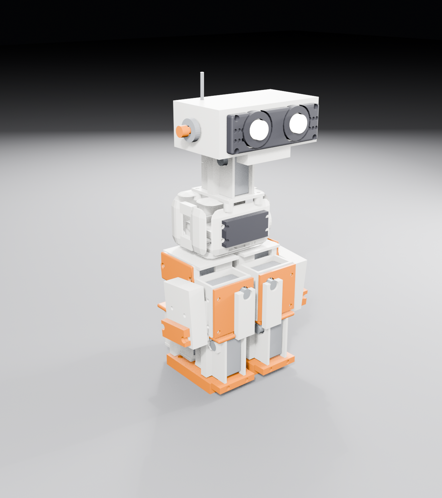
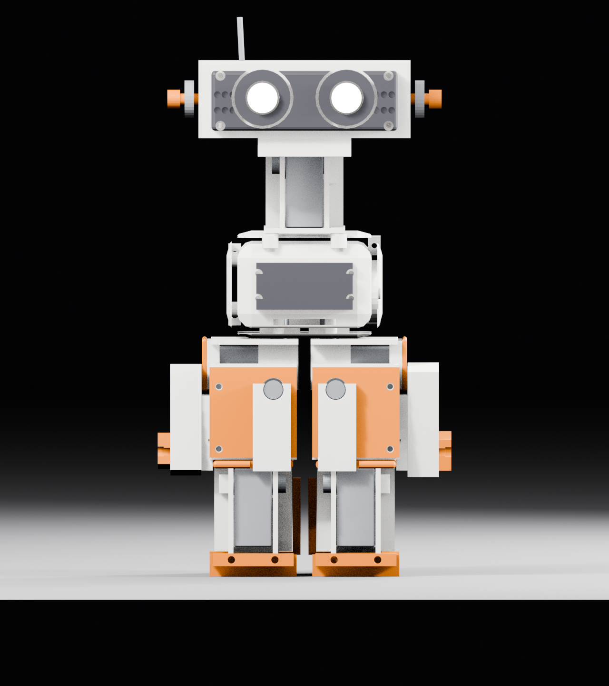
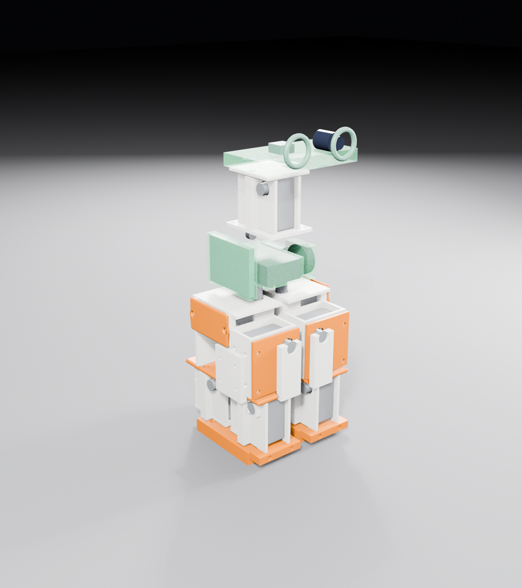

# Knoll Mini — ~16 cm pocket BDX-style biped

The compact, buildable derivative: Microduck's architecture (5-DOF legs, static flipper shells,
actuated neck) shrunk to pocket size around **cheap serial-bus servos**, with a Disney BDX-style
slab head whose two lamp-eyes double as the robot's sensors.

- **Height:** ~165 mm (target window 150–200 mm) · **est. mass** ~250 g · **est. BOM** ≈ £200
- **DOF:** 9 — 8 leg (4/side: yaw, roll, pitch, knee; ankle is a passive compliant foot)
  + 1 neck (pitch) — all SCS0009/SC09 serial servos (~£105)
- **Eyes:** left = OV2640 camera, right = VL53L0X ToF, each behind a WS2812 ring so they still glow





## What's here

| Path | Contents |
|------|----------|
| `build_knoll_mini.py` | Parametric generator — Blender 4.x headless, rebuilds renders + production STLs |
| `verify_parts.py` | Fit verifier — manifold/volume checks, component clearance, part interference, insert seats |
| `knoll-mini.blend` | Editable model; collections `LEG_L/R`, `TRUNK`, `ARMS`, `NECK`, `HEAD`, `COMPONENTS`, `SLOTS`, `HARDWARE` |
| `img/` | hero, front, side, rear, head-detail, servo-station, internals renders |
| `parts/` | **44 production STLs** — every part a single fused manifold solid |
| `BOM.md` | Component cost + servo config decision (~£185) |
| `DESIGN-REVIEW.md` | Architecture, torque budget, eye-sensor rationale, open risks |
| `ASSEMBLY.md` | Print settings, insert map, step-by-step build, QC checklist |
| `WIRING.md` | Servo daisy-chain, power tree, signal routes, strain relief |

## Rebuild

```bash
# model + production STLs + renders
blender --background --python build_knoll_mini.py -- --out .

# verify the saved blend: solids, component fits, part interference, inserts
blender --background knoll-mini.blend --python verify_parts.py
```

Every dimension is a named constant at the top of the script (`SV`, `FEMUR`, `TRUNK`,
`HEAD_W`…). Change the servo constant and the whole frame re-fits itself.

## Component map (slots)

The `SLOTS` collection holds translucent envelopes showing exactly where each part sits;
`COMPONENTS` holds the parts themselves:

- **Trunk (40×50×34):** 2S LiPo (bottom) → ESP32-S3 + bus hub + buck (mid stack) → BNO085 IMU (top) → 16 mm speaker (behind chest panel); power button + USB port on rear
- **Head (68×38×24):** camera pod (behind left eye), ToF pod (behind right eye), 2× WS2812 rings, `SLOT_HEAD_ELEC` tray for the flex/mic run
- **Neck:** NPITCH servo block stands on the trunk top — the exposed mechanical column
  (BDX-faithful visible actuator); NECK_ARM horn link carries the head base; NECK_CABLE
  conduit routes the flex run up the back
- **Legs:** 4× SCS0009 per side in a serial chain — hip block (yaw output + roll body) →
  femur (pitch) → shin (knee) → passive foot/ankle; each member holds one servo body and
  is driven by the previous joint's horn

## Assembly — no glue, all mechanical

Every part mounts with **M2 screws into M2 heat-set brass inserts** (65 total):

- **Servos (all 9):** drop into printed pockets (0.6 mm clearance), a collar plate clamps the
  ear flange, 2× M2 screws into boss posts beside the pocket. Horn exits the open side.
- **Trunk:** `TRUNK_F` + `TRUNK_R` clamshell halves join on 6 seam inserts; chest panel on
  4 posts; battery sits in a tray with strap slots (velcro tie, not glued); PCB on 4 standoff
  posts; IMU on 2 posts; speaker press-fits a ring behind the panel.
- **Head:** `HEAD_SHELL` + `HEAD_BASE` screw together at 4 corners; base plate has the
  NPITCH horn bore + cable slot; `FACE_PLATE` screws on at 4 corners with real bored eye
  apertures; camera/ToF pods sit in printed brackets; eye bezels press-fit the bores.
- **Neck:** NPITCH is the exposed column block, bolted through the trunk top face into
  inserts; its horn drives the head base through `NECK_ARM`.
- **Feet:** sole plate screws up into the foot frame from below (4× M2).
- **Flippers:** 2× M2 each into trunk-side inserts.

All fasteners/inserts are modeled as objects in the `HARDWARE` collection (hidden in beauty
renders, shown in `servo-station.png`). `parts/` holds **44 STLs** — the full printable kit.

## Honest status

**Digitally verified build-ready geometry** — `verify_parts.py` PASSes on the saved blend:
all 44 parts are positive-volume manifold solids, all 29 component proxies clear the shells
volumetrically, no printed parts intersect, and all 65 heat-set insert seats sit in material.
Still unverified physically: knee torque margin (BOM.md), self-recovery in sim, and real-world
print tolerances. **Next step: print a servo station (one pocket + collar) plus a hip block
for a fit check before committing to the whole kit.**
