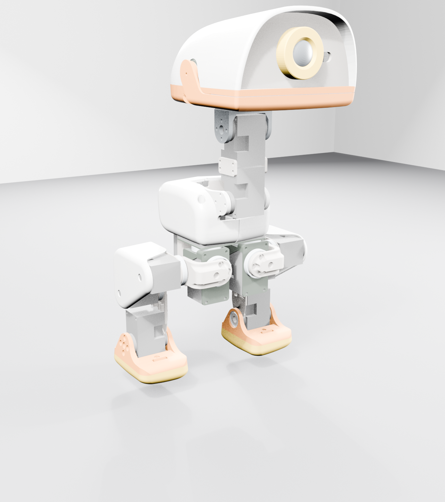
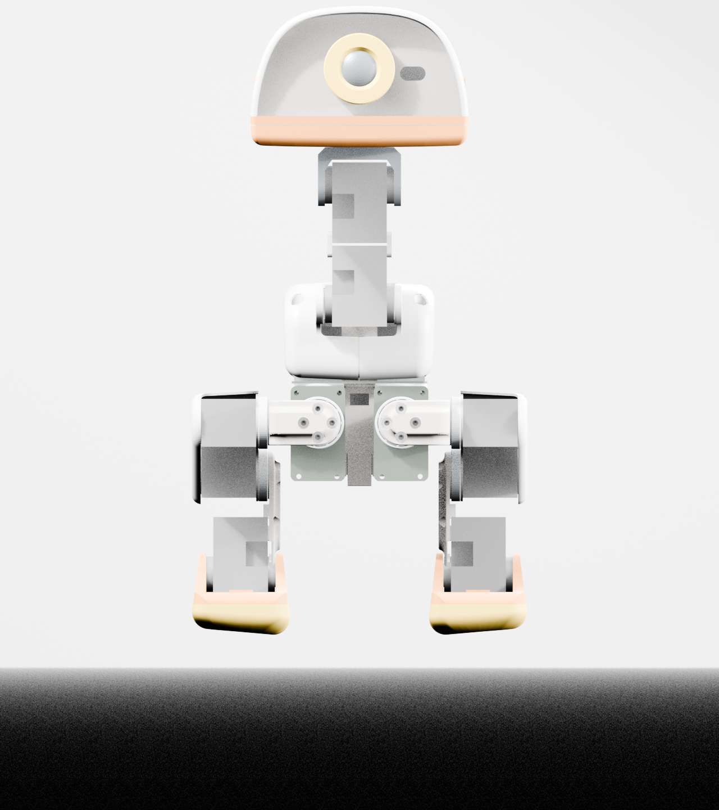
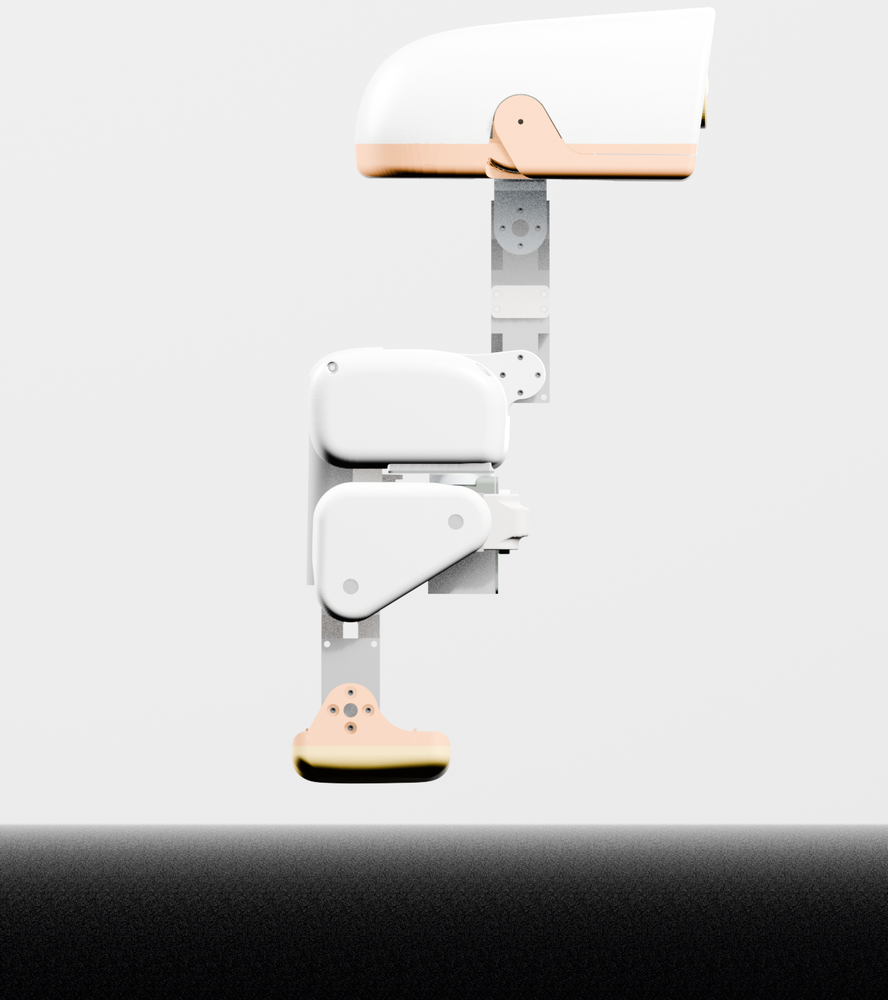
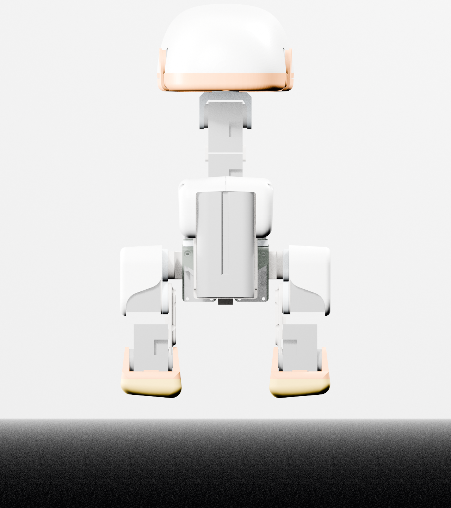
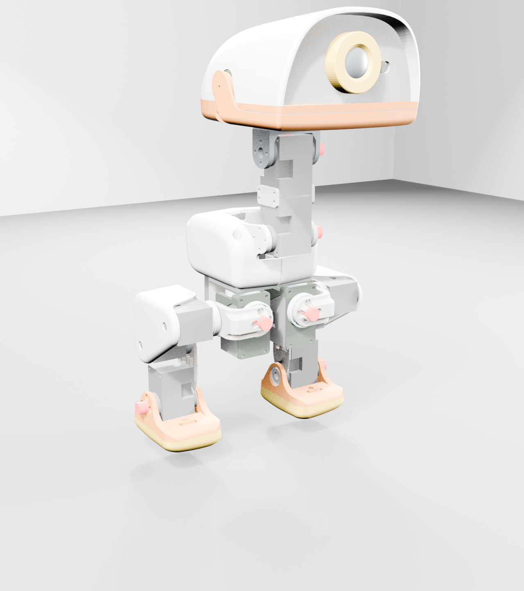
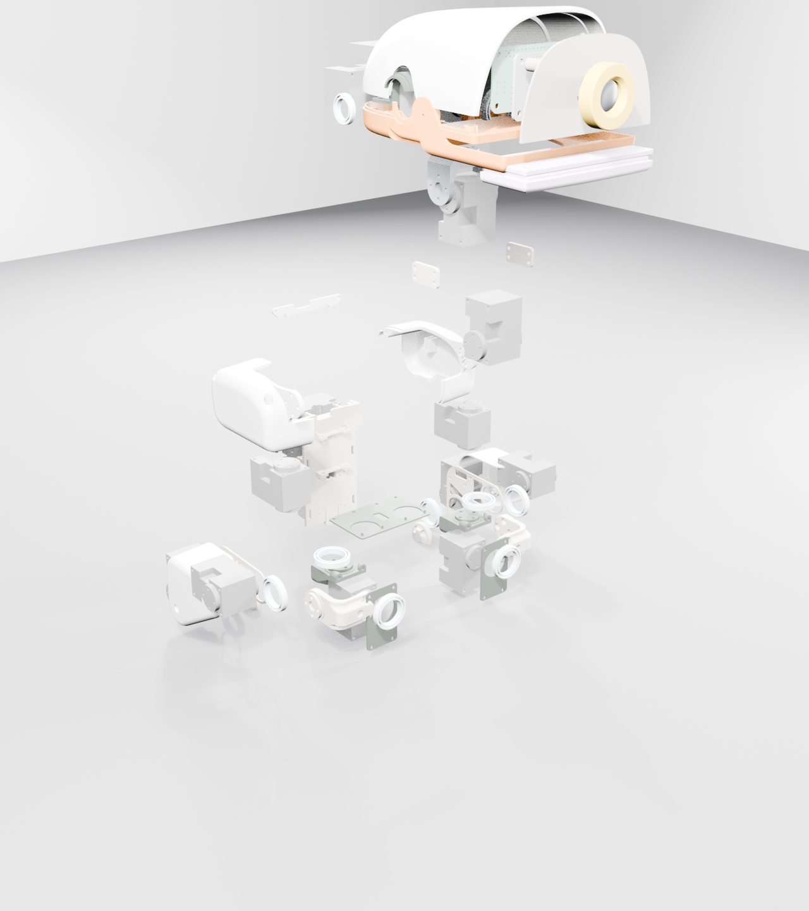

# Microduck Reference Assembly (microduck-reference-v0)

A **faithful, part-for-part reconstruction** of Pollen Robotics / Hugging Face
**Microduck**, built from the official robot model. This is reference
material — the baseline the Knoll redesign will diverge from. It is *not*
original Knoll geometry. See `THIRD-PARTY-NOTICES.md`.

## What is here

| File | Contents |
|---|---|
| `img/*.png` | 8 renders: hero ¾, front, side, rear, top, DOF map, exploded, head + feet details |
| `microduck-reference-v0.blend` | Editable Blender 4.5 scene — 70 part instances from 38 unique meshes, all individually selectable |
| `build_assembly.py` | Reproducible build: parses the official MJCF and assembles parts with exact transforms |
| `parts-manifest.csv` | Every placed part: name, source MJCF body path, STL, world position — plus all 14 joints with ranges |
| `DESIGN-REVIEW.md` | Fidelity notes, architecture extracted from the model, alteration roadmap |
| `THIRD-PARTY-NOTICES.md` | Attribution and licensing |

## Source of truth

Everything is placed by parsing
`pollen-robotics/microduck_rl` → `src/mjlab_microduck/robot/microduck/robot_walk.xml`
(the same MJCF that drives their trained policies). Part poses come from the
nested `<body pos quat>` tree + per-`<geom>` offsets — so placement, joint
locations, axes and ranges are exact, not eyeballed. Official MuJoCo material
colors are applied from the XML `<material rgba>` definitions.

## Regenerating

```bash
# 1. fetch the official assets (sparse, ~15 MB)
git clone --depth 1 --filter=blob:none --sparse \
  https://github.com/pollen-robotics/microduck_rl.git /tmp/microduck_rl
cd /tmp/microduck_rl && git sparse-checkout set --skip-checks \
  src/mjlab_microduck/robot/microduck

# 2. rebuild the scene + renders (Blender 4.5+)
blender --background --python build_assembly.py -- \
  --md-dir /tmp/microduck_rl/src/mjlab_microduck/robot/microduck \
  --out .
```

`--quick` renders only the hero shot.

## Renders

 
 
 

Status: **reference assembly, exact placement — not yet Knoll geometry.**
Label any image derived from it as a Microduck derivative, © Pollen Robotics.
