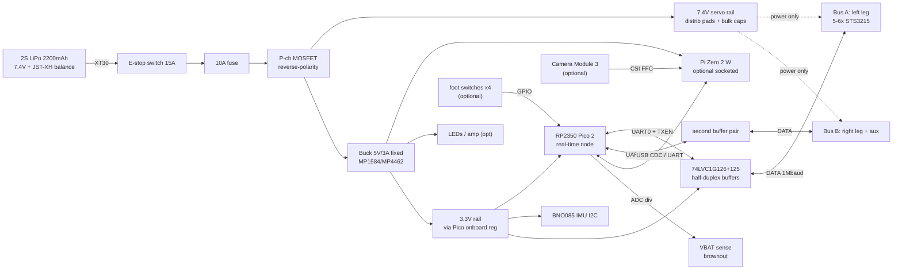

# Electronics Architecture Notes — Project MASCOT

**Version:** 0.1 — 2026-10-26 — PRELIMINARY
**Scope:** Electronics for a ~26–32 cm, ~1 kg bipedal mascot robot, 10–14 serial-bus smart servos on a 7.4 V (2S) bus, per `design/shared-design-brief.md` v0.1.
**Price date for all GBP figures:** 2026-10-26. All prices inc. VAT unless marked "ex VAT".
**Convention:** FACT = cited spec; EST = engineering estimate; ASSUME = planning assumption needing validation.

---

## 1. Recommended architecture (summary)

**Recommendation: split architecture — RP2350-class MCU real-time layer + optional Raspberry Pi Zero 2 W high-level layer, with a clean "MCU-only tethered" fallback mode.**

- **Real-time node:** Raspberry Pi Pico 2 (RP2350) on a small custom carrier PCB ("servo/power board"). Runs the 50–200 Hz servo bus loop, IMU sampling, e-stop/brownout handling. Dual hardware UARTs map neatly onto two daisy-chained servo buses.
- **High-level node (optional, socketed):** Raspberry Pi Zero 2 W for RL policy inference / camera / WiFi telemetry. Communicates with the MCU over USB CDC (Pico device → Pi USB-OTG host) or 3.3 V UART. **The robot must stand, idle-balance and e-stop safely with the SBC absent or crashed** — the MCU owns all safety.
- **v1 fallback:** MCU-only, tethered to a desktop via USB CDC. Cheapest, fastest to bring up; the socket/connector plan keeps the SBC an add-on, not a redesign.

**Why not the alternatives:**
- *ESP32-S3 as sole controller* — fine MCU (3 UARTs, native USB, £9.60) but WiFi stack adds RT jitter; its 240 MHz LX7 has no deterministic-IO advantage over RP2350's PIO. Keep as comms/telemetry co-processor option only if WiFi-on-MCU is wanted without an SBC.
- *STM32G4/F4* — excellent peripherals (many UARTs, op-amps, timers) but dev boards (Nucleo ~£12–17) are bigger/costlier than Pico 2, and the hobby ecosystem for serial-servo bipeds (SDKs, reference adapter designs) is thinner.
- *CM4/CM5* — module alone £24–76 + requires a carrier board (mezzanine connectors, more design effort, more mass). Overkill for v1.
- *Radxa Zero 3W* — ~£77 on Amazon UK, weaker UK supply chain, worse docs than Pi. Not justified.
- *MCU-only forever* — can't run camera or heavier policy stacks; fine for MVP only.

**Mass estimate of electronics (ex-servos, ex-battery):** Pico 2 ~3 g + carrier PCB ~15 g + Pi Zero 2 W ~12 g + camera ~4 g + IMU ~3 g + buck/BMS/connectors/wire ~25 g ≈ **60–65 g**. Battery adds ~110–120 g (2S 2200 mAh LiPo). Fits the 0.9–1.3 kg envelope.

**Rough electronics cost (ex-servos): ~£75–95 core / ~£110–130 with options** — see BOM §11. ⚠️ **Servos dominate the budget**: 12 × STS3215-class ≈ £268–315 at UK retail (§5, §11), nearly the entire £320 all-in target alone. Flagged to actuators workstream — see §14.

---

## 2. Real-time controller MCU comparison

| MCU / board | UK price (2026-10-26) | Cores / clock | UARTs (hw) | USB | Toolchain | RT suitability | Notes |
|---|---|---|---|---|---|---|---|
| **RP2350 — Pi Pico 2** | £4.00 (no hdr) / £4.75 (hdr) Pimoroni; £3.67 ex VAT Rapid | 2× Cortex-M33 150 MHz (or 2× RISC-V Hazard3) | 2 (+PIO UARTs) | Native USB FS (device+host via OTG) | pico-sdk C/C++, MicroPython, CircuitPython, Rust | Excellent: deterministic, PIO for custom timing, 520 KB SRAM, 4 MB flash | In production "until at least January 2040". Sources: [Pimoroni](https://shop.pimoroni.com/products/raspberry-pi-pico-2), [Rapid](https://www.rapidonline.com/raspberry-pi-pico-2-and-pico-2w-microcontroller-boards-595979) |
| RP2350 — **Pico 2 W** | £5.20 ex VAT Rapid (~£6.24 inc); in stock | same + CYW43439 WiFi/BT | 2 | same | same | same | WiFi on the MCU could replace tether *and* SBC for some configs — worth keeping in BOM as variant |
| RP2040 — Pico 1 | ~£4.00 class | 2× M0+ 133 MHz | 2 | USB FS | same | Good (no FPU though) | Superseded by RP2350 for +£0–1; keep as fallback |
| **ESP32-S3** dev boards | £9.60 Waveshare 16MB (Pi Hut); £9.90 Baguette S3 (Pi Hut); £14.50 NanoS3 (Pimoroni) | 2× Xtensa LX7 240 MHz + ULP RISC-V | 3 | Native USB OTG + USB-serial-JTAG | ESP-IDF, Arduino, MicroPython, Rust | Good for control but WiFi/BT coexistence causes latency spikes; no PIO-equivalent | Cheapest path to onboard WiFi without an SBC. Sources: [Pi Hut Waveshare](https://thepihut.com/products/esp32-s3-microcontroller-development-board-1), [Pi Hut Baguette](https://thepihut.com/products/baguette-s3-esp32-s3-prototyping-board) |
| **STM32G431** Nucleo-G431RB | £16.90 ex VAT RS (~£20.28 inc); Farnell from ~£11.65 ex VAT | 1× M4F 170 MHz + FPU | 3–4 (USART1/2/3 + LPUART) | via ST-LINK | STM32CubeIDE, mbed, Rust | Excellent: HW FPU, advanced timers, true 5 V-tolerant pins on some ports | Bare G431CBU6 chip ~£3–4 (indicative, needs verification) if we spin our own board — viable Rev2. Sources: [RS](https://uk.rs-online.com/web/p/microcontroller-development-tools/1962536), [oemsecrets](https://www.oemsecrets.com/details/nucleog431rb) |
| STM32F401 Nucleo | £12.65 ex VAT Farnell (~£15.18 inc) | 1× M4F 84 MHz | 3 | via ST-LINK | same | Good | Older, less capable than G4 |

**Choice: RP2350 (Pico 2).** 2 hw UARTs + PIO cover the two-bus servo plan; £4 is trivially cheap; vast hobby community; the bus-servo reference designs (Waveshare) target exactly this MCU class. Pico 2 W (+~£2) adds WiFi telemetry without an SBC — recommended as the default purchase.

---

## 3. Onboard computer (SBC) options

| Option | UK price (2026-10-26) | Mass | Power draw | Thermals | Supply/notes |
|---|---|---|---|---|---|
| **Pi Zero 2 W** | £12.00–14.40 (Pimoroni/Pi Hut); WH +~£2.60 | ~12 g (FACT, board) | ~0.6 W idle, ~2.9 W full load (FACT, measured) | Negligible at this scale; no heatsink needed for bursts | Stock historically spotty — **was listed in stock at Pimoroni / sold out at Pi Hut on check date**; buy early. Sources: [Pimoroni](https://shop.pimoroni.com/products/raspberry-pi-zero-2-w), [Pi Hut](https://thepihut.com/products/raspberry-pi-zero-2), [CNX power measurements](https://www.cnx-software.com/2021/12/09/raspberry-pi-zero-2-w-power-consumption/) |
| CM4 (Lite 1GB) | from £24 (module only, Pi Hut) — + carrier board needed | 7 g module + carrier ~20–40 g | ~2–4 W | OK | Adds mezzanine-carrier design effort; not v1. Source: [Pi Hut CM4](https://thepihut.com/products/raspberry-pi-compute-module-4) |
| CM5 | ~(>£45 module, indicative) | similar | 3–6 W | needs airflow/pad | Overkill; check if Microduck-parity inference is ever on-device |
| Radxa Zero 3W 2GB | £76.99 Amazon UK | ~12 g | ~1–3 W (est.) | OK | Poor UK supply vs Pi; RK3566+NPU interesting but docs thinner. Source: [Amazon UK](https://www.amazon.co.uk/Radxa-3W-Computer-2GB-GPIO/dp/B0CZD16K7Q) |
| **NONE (MCU-only + desktop tether)** | £0 | 0 | 0 | — | Valid v1 config: Pico 2 talks USB-CDC to a laptop running the policy; 1–2 m USB cable or WiFi if Pico 2 W used |

**Recommendation:** design for, but don't require, **Pi Zero 2 W** (quad A53 1 GHz, 512 MB — enough for ONNX/TFLite policy at 50 Hz + camera capture). Provide a 5 V/2.5 A-capable rail and a 3-pin UART or USB link to the MCU. Robot remains fully functional (stand/recover-idle/fallback gait) on MCU alone.

---

## 4. IMU candidates

| IMU breakout | UK price | Fusion? | Interface | Notes |
|---|---|---|---|---|
| **Adafruit BNO085** (STEMMA QT) | £26.99 SB Components; £28.40 Pi Hut; $29.50 Adafruit | **Yes — on-chip SH-2 fusion**, quaternion/rotation-vector out | I2C/SPI/UART | "Just works" fused orientation; frees MCU from fusion math. CEVA Hillcrest firmware. Sources: [SB Components](https://shop.sb-components.co.uk/products/adafruit-9-dof-orientation-imu-fusion-breakout-bno085-bno080-stemma-qt-qwiic), [Adafruit](https://www.adafruit.com/product/4754) |
| SparkFun BNO086 VR | £36.90 Pi Hut | Yes (enhanced) | I2C/SPI | Newer sibling; not worth +£8 vs BNO085 for v1 |
| SparkFun ICM-20948 9DoF | £21.50 Pi Hut | Raw only (DMP limited) | I2C/SPI | Good raw quality; we'd run our own fusion (Mahony/EKF) on RP2350 |
| **SparkFun BMI270 6DoF** | £17.80 Pi Hut | Raw + step/gesture features | I2C/SPI | No magnetometer; low noise; cheap Bosch part. Source: [Pi Hut](https://thepihut.com/products/sparkfun-6dof-imu-breakout-bmi270) |
| GY-521 MPU-6050 clones | £1.66–4.49 (Hobby Components/eBay) | Raw only (DMP archaic) | I2C | EOL part, clone lottery, noisy. **Dev/bring-up only.** Sources: [Hobby Components](https://hobbycomponents.com/sensors/176-gy-521-mpu-6050-module-3-axis-gyro-3-axis-accelerometer-module), [eBay](https://www.ebay.co.uk/itm/365478139204) |

**Recommendation: BNO085 breakout for v1** (fused quaternion over I2C/Qwiic at up to 400 Hz; the RL policy wants orientation, not raw axes). Fall back to BMI270 + on-MCU Madgwick if cost pressure demands (−£10). Buy the breakout for v1; on Rev2 PCB a BNO085/BNO086 chip-down design is ~£8–10 of BOM (EST). Mount on the torso near CoM, foam-tape isolated from servo vibration (ASSUME — validate by measuring).

---

## 5. Servo bus interface circuit (half-duplex TTL)

The STS3215-class bus is **single-wire half-duplex TTL async serial, 38.4 k–1 Mbaud**, on a 3-pin 5264-3A (Molex KK254-compatible 2.54 mm) connector: `GND | DATA | 7.4 V` (FACT — [Waveshare bus-servo driver schematic](https://files.waveshare.com/wiki/SC15_Servo/Bus_servo_driver_circuit_schematic.pdf), [RobotShop STS3215 listing](https://uk.robotshop.com/products/magnetic-encoding-servo-sts3215-74v-19kgcm)).

**Proven reference circuit (Waveshare Bus Servo Adapter, open schematic — cite for our derivative):**
- `SN74LVC1G126` (tri-state buffer): MCU_TX → DATA, output-enabled by `TXEN`
- `SN74LVC1G125` (tri-state buffer): DATA → MCU_RX
- `TXEN` auto-generated: S8550 PNP + RC from MCU_TX edge, or (better for us) a dedicated MCU GPIO = deterministic direction control — Waveshare uses the PNP trick so host UART dongles need no extra pin; on our own MCU a GPIO is cleaner and glitch-free
- 10 kΩ pull-ups on DATA/3V3; 100 nF decoupling per buffer; connector `5264-3A`
- Source schematic: [Waveshare adapter PDF](https://files.waveshare.com/wiki/Bus_Servo_Adapter_A/Bus_Servo_Adapter_A.pdf) (also shows their USB-UART adapter using CH343P + MP1658 buck + AO4407 P-ch input protection + SMAJ15CA TVS — a useful full reference)

**Our design choices:**
- Buffers run at **3.3 V** (74LVC is 5 V-tolerant on inputs; 3.3 V drive is accepted as TTL-high >2.0 V by Feetech servos — the entire SO-ARM/LeRobot ecosystem drives these buses from 3.3 V). If marginal units appear, option-populate the buffers' VCC at 5 V and level-shift MCU_RX through a divider — note as DFM option.
- **Two independent buses:** UART0 → left-leg chain, UART1 → right-leg + aux chain. Halves bus latency and fault domain; a ripped leg cable can't wedge both legs. GPIO TXEN ×2.
- **ESD/transient:** SMAJ5.0A or SMBJ5.0A TVS on each DATA line + 100 Ω series resistor between buffer Y and the servo connector (limits ESD energy into the LVC pin). Servo shells take real ESD hits on carpet.
- **Hot-plug note:** servos share a noisy 7.4 V rail; add 100–220 µF bulk cap near each branch's first connector.
- Alternative "one-wire" trick (TX/RX tied via ~1 kΩ) saves 2 ICs but forfeits glitch isolation and is fragile at 1 Mbaud — not recommended for a productised open design.
- Connector: keep **5264-3A / KK254 3-pin** footprints to accept stock servo leads (they ship with 5264 pigtails). Do NOT use JST-XH (looks similar, doesn't latch properly — known interop trap). Provide also 2.54 mm pads for dupont during bring-up.

Parts: SN74LVC1G126DBVR ≈ £0.25, SN74LVC1G125DBVR ≈ £0.25, passives ≈ £1, 5264 headers ×6–8 ≈ £2 (indicative, RS/Farnell/AliExpress — verify at order time).

---

## 6. Power architecture

```
2S battery → XT30 → [E-STOP/SWITCH] → [FUSE 10A] → [P-MOSFET rev-pol] → 7.4V_SERVO rail
   │                                                            │
   │                                            (servo power enters at distro
   │                                             board, NEVER through MCU/SBC)
   └→ 7.4V → [BUCK 5V/3A] → 5V rail → Pi Zero 2W, camera, LEDs, amp
                      └→ [LDO 3.3V] → RP2350, IMU, bus buffers
```

**Topology rules:**
- Servo current flows **only** on the 7.4 V rail: battery → switch → fuse → distribution pads → 5264 connectors. The MCU sees the servo rail only via an ADC sense divider (100 k/10 k → ~0.68–0.76 V at 6.0–8.4 V) for brownout detection.
- **Reverse polarity:** P-MOSFET (e.g., AO4407-class, as in Waveshare's adapter) on the input — ~0 V drop vs ~0.4 V for a Schottky. Schottky fallback: SS34 acceptable at ≤3 A logic-side draw but wasteful.
- **Fuse:** 10 A automotive blade or 1812 PTC resettable (e.g., 7–10 A hold). Servo stall bursts are spiky; PTC may nuisance-trip during get-up — prefer a real fuse for the servo rail, PTC on the 5 V branch.
- **E-stop / hardware cut:** a latching metal toggle or slide switch rated ≥15 A in the battery lead, torso-accessible, labelled. Software "torque-off" is a second layer, not the safety cut.
- **5 V rail:** fixed-output buck (no adjustable-pot modules in the robot — vibration turns pots; the classic failure). MP1584 fixed-5 V module £0.76–3.64 (Bitsbox/247geek) or MP4462-based £3.58; for a Pi Zero 2W + camera at ~2.9 W peak, a 3 A buck has ~2× headroom. Sources: [Bitsbox](https://www.bitsboxuk.com/index.php?cPath=140_171&main_page=index), [247geek](https://247geek.co.uk/mp1584fixed5v).
- **3.3 V:** the Pico 2's own regulator powers MCU+buffers; IMU (≤5 mA) also fine on it. If buffers go to 5 V VCC, add a tiny LDO only for IMU — actually keep all logic at 3.3 V, one LDO domain.
- **Brownout:** 7.4 V rail sags when many servos surge → can brownout the buck→SBC. Mitigations: ≥470 µF low-ESR bulk on 5 V buck input + 220 µF on output; MCU ADC watches VBAT and (a) derates servo torque/current limits in firmware below ~6.6 V, (b) asserts torque-off below ~6.0 V. Pi gets its 5 V from the buck, not from the servo rail directly.
- **Inrush:** servo bus bulk caps can spark at connect — XT30 connectors tolerate it; optionally add a 10 Ω/1 s precharge pin header for bench use (nice-to-have).
- **Battery choice:**
  - *2S LiPo pouch (recommended v1):* 2200 mAh 35C £14.99 (Howes), 1500 mAh 85C £9.95 (ScotiaRC, 74×35×16 mm), 2000 mAh 5C w/ barrel £13.66 (RobotShop, 63.5 g). Hobby LiPo + external balance charger; add a cheap LiPo low-voltage buzzer or rely on MCU ADC alarm.
  - *2× 18650 + 2S BMS:* safer abuse profile, more cycle life, but ~90–100 g for 2 cells +holder and only ~3 A/cell on generic cells (need high-drain cells for servo peaks → costlier). BMS 2S 8 A board £2.90 (Kunkune). Viable alternative; heavier and bulkier.
  - Sources: [Howes Models](https://howesmodels.co.uk/product-category/batteries-chargers/li-po-batteries-and-chargers/7-4v-li-po-batteries/), [ScotiaRC](https://www.scotiarc.co.uk/product/gpr-7-4v-2s-1500mah-85c-lipo-battery/), [RobotShop](https://uk.robotshop.com/products/74v-2000mah-5c-lipo-battery-eu), [Kunkune BMS](https://kunkune.co.uk/shop/uncategorized/2s-8a-7-4v-8-4v-18650-li-ion-lithium-battery-charger-protection-board-bms/)

---

## 7. Power budget (12-servo build; per-brief assumption 1 A/servo peak cap, 150–300 mA typical)

FACT anchor (STS3215 @6–7.4 V): no-load running 150 mA, stall 2.0–2.7 A, rated torque ~1/3 stall → plan for firmware current limiting to ~1 A/servo ([RobotShop STS3215 specs](https://uk.robotshop.com/products/magnetic-encoding-servo-sts3215-74v-19kgcm)).

| Load | Typical (EST) | Worst-case simultaneous (EST) | Rail |
|---|---|---|---|
| 12× servo, gait @ ~150–200 mA avg each | 1.8–2.4 A | 12×1 A = **12 A** (bounded by FW limit; true 24 A all-stall is prevented) | 7.4 V |
| Pi Zero 2 W + camera | 0.15–0.3 A @5V (0.75–1.5 W) | 0.6 A @5V (~3 W) | 5 V |
| RP2350 + buffers + IMU | ~0.05 A @3.3V | 0.15 A | 3.3 V |
| LEDs (4–8 WS2812-class, mascot eyes) | 0.05–0.2 A @5V | 0.5 A @5V | 5 V |
| Speaker amp (MAX98357A, opt.) | ~0.05 A | 0.6 A @5V | 5 V |

⚠️ **Typical correction:** 1.8–2.4 A servo draw assumes all servos continuously loaded — pessimistic for level walking; expect ~0.8–1.5 A total servo current (6–11 W) with brief 4–8 A surges during steps/recovery (EST, needs bench validation). Using conservative 1.5 A servo + 0.3 A logic typical:

- **Typical system ≈ 1.5 A servo + ~0.35 A logic-side (bat-referred) ≈ ~14 W**
- **45 min target → need ~10.5 Wh usable → 7.4 V × 2200 mAh × 0.8 depth ≈ 13 Wh ✓ (marginal but OK); 1500 mAh gives ~8.9 Wh ≈ 35–40 min — recommend 2200–3000 mAh pack**
- **Peak design current:** fuse 10 A continuous / 15 A slow-blow; wire 20 AWG silicone on servo trunk, 22–24 AWG to each 5264 branch, 24–26 AWG logic. XT30 battery connector (60 A peak rating, compact); JST-XH balance lead brought out for charging.
- The 5 V buck (3 A) covers SBC+camera+LED worst case ~1.7 A with headroom.

---

## 8. Camera

| Option | UK price | Notes |
|---|---|---|
| **Pi Camera Module 3** (IMX708 12 MP, AF, HDR) | £24 Pi Hut; £30–41 Amazon variants | Needs 22-pin↔15-pin FFC for Zero (standard version ships with it). Source: [Pi Hut](https://thepihut.com/products/raspberry-pi-camera-module-3) |
| **ZeroCam OV5647** (Pi Hut) | £15 | Zero-native 22-pin cable, 5 MP, fixed focus — cheap and light for vision-policy experiments |
| OV5647 clones | £8–17.50 (eBay/proto-pic) | variable quality |

**Recommendation: mark camera OPTIONAL for v1.** Locomotion/self-recovery policies run on IMU+proprioception (joint encoders in the servos) alone — Microduck-class minimal policy doesn't strictly need vision. The PCB keeps a Zero-camera cable route clear; add camera in v1.5 when a vision-conditioned policy is attempted. Saves £15–24 and ~0.5 W on the base build.

## 9. Foot contact sensing & audio (optional)

- **Foot contact:** simple **microswitch or conductive-foam "squish" switch** per foot (~£0.5–1 ea) is more robust than FSRs at 1 kg robot loads. FSR (Alpha 0.5″ £3.80 Pi Hut / Interlink FSR402 £7.56 Rapid) only if graded contact force is wanted — they're noisy and drift. Recommend: 2 digital contact pads/foot to ADC-free GPIO with RC debounce; FSR as an option footprint. Sources: [Pi Hut FSR](https://thepihut.com/products/round-force-sensitive-resistor-fsr), [Interlink FSR402](https://www.interlinkelectronics.com/products/fsr-model-402)
- **Audio (future AI mascot features):** MAX98357A I2S 3 W class-D breakout £5.40–5.70 (Pi Hut/SB) + 4 Ω/3 W micro speaker ~£3; mic via Pi USB or INMP441 I2S mic ~£3–5. Optional header on 5 V rail; drive I2S from the Pi (GPIO), not the MCU. Source: [Pi Hut MAX98357A](https://thepihut.com/products/adafruit-i2s-3w-class-d-amplifier-breakout-max98357a)

---

## 10. Functional block diagram



ASCII alternative:

```
+-----------------+   XT30   +--------+  10A  +---------+
| 2S LiPo 2200mAh |--------->| E-STOP |----->| P-FET   |---+
|  + JST-XH bal   |          | switch | fuse | rev-pol |   |
+-----------------+          +--------+      +---------+   |
        |                                                 |
        |            +---------------+                    |
        +----------->| 7.4V SERVO BUS |----[5264 x6]---> BUS A: L leg servos
                     | (star distro,  |----[5264 x6]---> BUS B: R leg + aux
                     |  NEVER via MCU)|
                     +-------+-------+
                             |
                     +-------v-------+    +-----------------+
                     | Buck 5V/3A    |--->| Pi Zero 2W (opt)|--[CSI]--> Camera (opt)
                     | fixed output  |    +--------+--------+
                     +-------+-------+             | USB-CDC/UART link
                             |                   |
                     +-------v-------+    +------v---------+
                     | 3.3V logic    |--->| RP2350 Pico 2  |
                     +-------+-------+    |  - UART0 -> 74LVC1G126/125 -> DATA bus A
                             |            |  - UART1 -> 74LVC1G126/125 -> DATA bus B
                     +-------v-------+    |  - I2C -> BNO085 IMU
                     | BNO085, LED,  |    |  - ADC <- VBAT divider (brownout)
                     | buffers, FSRs |    |  - GPIO -> foot switches / e-stop sense
                     +---------------+    +-----------------+
```

---

## 11. Candidate component list (BOM CSV format per brief)

`category,item,part_number,manufacturer,qty,unit_price_gbp,source_url,supplier,price_date,price_type,mass_g,notes,alternative`

```csv
category,item,part_number,manufacturer,qty,unit_price_gbp,source_url,supplier,price_date,price_type,mass_g,notes,alternative
MCU,Raspberry Pi Pico 2 W (RP2350+WiFi),SC1633,Raspberry Pi,1,6.24,https://www.rapidonline.com/raspberry-pi-pico-2-and-pico-2w-microcontroller-boards-595979,Rapid Electronics,2026-10-26,verified,4,"£5.20 ex VAT; WiFi enables tether-free MCU-only mode","Pico 2 non-W SC1632 £5.39 inc (£4.49 ex)"
MCU,ESP32-S3 dev board (alt MCU option),ESP32-S3-WROOM-1-N8R8 board,Waveshare/Pi Hut,0,9.60,https://thepihut.com/products/esp32-s3-microcontroller-development-board-1,The Pi Hut,2026-10-26,verified,10,"alternative architecture only; 3 UARTs native USB","TinyS3 £? Pimoroni"
SBC,Raspberry Pi Zero 2 W,SC1176,Raspberry Pi,1,14.40,https://thepihut.com/products/raspberry-pi-zero-2,The Pi Hut,2026-10-26,verified,12,"quad A53 1GHz 512MB; check stock — sold out at Pi Hut / in stock at Pimoroni on check date","CM4 Lite 1GB £24 (needs carrier); Radxa Zero 3W £77"
IMU,BNO085 9-DoF fusion breakout STEMMA-QT,Adafruit 4754,Adafruit,1,28.40,https://thepihut.com/collections/imu-gyro-sensors,The Pi Hut,2026-10-26,verified,2.5,"on-chip SH-2 fusion quaternion out; I2C Qwiic","BMI270 breakout £17.80 (raw); ICM-20948 £21.50"
IMU,MPU-6050 GY-521 clone (dev only),GY-521,generic,0,3.34,https://www.ebay.co.uk/itm/151830816714,eBay UK,2026-10-26,verified,5,"bring-up/backup only; noisy clones",-
SERVO_IF,Tri-state buffer TX->DATA,SN74LVC1G126DBVR,TI,2,0.30,https://uk.rs-online.com/ (verify),RS,2026-10-26,estimate,0.01,"per Waveshare reference design; 3.3V VCC","74HC126 quad £0.5"
SERVO_IF,Tri-state buffer DATA->RX,SN74LVC1G125DBVR,TI,2,0.30,https://uk.rs-online.com/ (verify),RS,2026-10-26,estimate,0.01,"direction GPIO controlled",-
SERVO_IF,TVS diode servo DATA,SMAJ5.0A,generic,2,0.15,-,RS/Farnell,2026-10-26,estimate,0.05,"ESD on DATA lines",-
SERVO_IF,Servo connector 3-pin 2.54mm,5264-3A / KK254,Molex-clone,8,0.40,-,CPC/AliExpress,2026-10-26,estimate,1,"matches stock servo pigtails; NOT JST-XH",-
PWR,Battery 2S LiPo 2200mAh 35C,generic 2S 2200,Howes Models,1,14.99,https://howesmodels.co.uk/product-category/batteries-chargers/li-po-batteries-and-chargers/7-4v-li-po-batteries/,Howes,2026-10-26,verified,115,"EST mass ~110-120g verify; XT60->reterminate XT30","2S 1500mAh 85C £9.95 ScotiaRC (74x35x16mm)"
PWR,2S 8A BMS board (if 18650 build),HX-2S-A10,generic,0,2.90,https://kunkune.co.uk/shop/uncategorized/2s-8a-7-4v-8-4v-18650-li-ion-lithium-battery-charger-protection-board-bms/,Kunkune,2026-10-26,verified,3,"18650 alternative only; LiPo uses balance charger",-
PWR,Buck 5V/3A fixed output,MP1584 fixed-5V module,generic,1,3.64,https://247geek.co.uk/mp1584fixed5v,247geek,2026-10-26,verified,4,"fixed output (no pot); Bitsbox M142 £0.76 alt (verify stock)","MP4462 5V3A £3.58 Bitsbox"
PWR,P-MOSFET reverse polarity,AO4407A,Alpha&Omega,1,0.40,-,Farnell,2026-10-26,estimate,0.05,"per Waveshare adapter ref","SS34 Schottky (worse)"
PWR,Fuse 10A + holder,mini blade/PTC,generic,1,1.50,-,CPC,2026-10-26,estimate,2,"servo rail; PTC alt on 5V branch",-
PWR,E-stop switch 15A toggle,latching toggle,generic,1,3.00,-,CPC/RS,2026-10-26,estimate,8,"torso accessible; hard power cut",-
PWR,XT30 pair battery-side,XT30U-M/F,Amass,1,2.00,-,CPC/hobby,2026-10-26,estimate,3,"60A peak rated","JST-XH (lower current)"
PWR,Bulk cap 470uF 16V low-ESR x2,generic,Panasonic/Rubycon,2,0.50,-,Farnell,2026-10-26,estimate,2,"buck input + servo rail",-
CAM,Pi Camera Module 3 (OPTIONAL v1),SC0872,Raspberry Pi,0,24.00,https://thepihut.com/products/raspberry-pi-camera-module-3,The Pi Hut,2026-10-26,verified,4,"mark optional; Zero FFC incl","ZeroCam OV5647 £15"
SENSE,Foot contact microswitch x4 (OPTIONAL),submini snap action,generic,4,0.60,-,CPC,2026-10-26,estimate,2,"digital GPIO w/ debounce","FSR Alpha 0.5in £3.80 Pi Hut x4"
AUDIO,MAX98357A I2S amp (OPTIONAL),Adafruit 3006,Adafruit,0,5.70,https://thepihut.com/products/adafruit-i2s-3w-class-d-amplifier-breakout-max98357a,The Pi Hut,2026-10-26,verified,2,"+ 4ohm 3W speaker ~£3; driven by Pi GPIO I2S",-
PCB,Carrier PCB 2-layer 50x80mm qty5,JLCPCB fab,JLCPCB,1,4.00,https://jlcpcb.com (USD $2-4/5 + ship),JLCPCB,2026-10-26,estimate,15,"fab ~$2/5 + UK ship ~$8-15; ~£10-20 landed","PCBWay $5/5 + ship"
MISC,microSD 32GB A2,generic,Samsung/Kingston,1,8.00,-,Amazon UK,2026-10-26,estimate,0.5,"for Pi image",-
MISC,5264/KK254 cable pigtails+crimps,5264-3A leads,generic,1,5.00,-,AliExpress/CPC,2026-10-26,estimate,15,"harness spares",-
MISC,Wire 20AWG silicone + 24AWG,-,generic,1,6.00,-,CPC,2026-10-26,estimate,40,"servo trunk + logic",-
```

**Indicative totals (EST):** core electronics (MCU+SBC+IMU+power+PCB+misc, no camera/FSR/audio): **~£75–95**. +camera £24, +4×microswitch £2.40, +audio £9 → **~£110–130 all-in ex-servos**. Servos at UK retail add **~£268–315** (12×£22.31–26.30) → **~£380–445 total, OVER the £320 target**. See §14 flag.

---

## 12. Connector / pin plan (RP2350 Pico 2, 40-pin)

| Function | Pico pin(s) | Notes |
|---|---|---|
| Servo Bus A TX/RX | UART0 TX=GP0, RX=GP1 | → 74LVC1G126/125 → DATA (5264 x N) |
| Bus A direction TXEN | GP2 | high=transmit |
| Servo Bus B TX/RX | UART1 TX=GP4, RX=GP5 | second buffer pair |
| Bus B direction TXEN | GP6 | |
| IMU I2C | SDA=GP8, SCL=GP9 (I2C0) | BNO085 @0x28; Qwiic pinout header kept |
| VBAT sense ADC | GP26 (ADC0) | 100k/10k divider; brownout ISR |
| 5V-rail sense (opt) | GP27 (ADC1) | buck health |
| SBC link | USB (native) or UART0-shared via mux? — prefer **USB CDC**; alt: SPI GP16-19 if USB OTG wiring proves awkward | Pi USB-OTG port ↔ Pico micro-USB |
| Foot switches ×4 | GP10–13 | pull-ups, RC debounce, interrupt-capable |
| E-stop sense (read-back) | GP14 | so MCU knows hard-cut occurred vs fault |
| Status LED / buzzer | GP15, GP22 | |
| Spare/expansion (neck servo PWM? fan?) | GP20,21,28 | |
| Debug SWD | 3-pin header | Pico std |

Servo pigtail pin order on 5264-3A: `GND — DATA — +7.4V` (verify against actual servo lead before PCB release — reversed-power protection via series diode is NOT possible on data/power combined connector; rely on keyed housing).

---

## 13. Design-for-test (DFT) notes

- Test pads: 7.4V, 5V, 3.3V, GND ×3, both DATA buses, TXEN lines, VBAT_sense — labelled on silkscreen, 2.54 mm pitch row for scope clips.
- Populate-option jumpers: buffer VCC 3.3V/5V select; servo rail bulk-cap footprint ×2; UART-link vs USB-link select; IMU I2C pull-up enable.
- Bring-up sequence: (1) board-only power on bench supply w/ current limit 100 mA → verify rails; (2) MCU hello + buffers loopback test (TXEN toggling, no servo attached); (3) single servo ID scan at 115200 then 1 Mbaud; (4) full bus current-limited walk; (5) battery.
- Firmware test hooks: servo bus ping-scan CLI over USB CDC; VBAT telemetry print; watchdog that torque-offs all servos if SBC heartbeat lost >500 ms.
- Known traps: 5264 vs XH lookalike connectors; adjustable-pot buck modules drifting under vibration (use fixed); USB-C cable between Pi-OTG and Pico needs OTG-aware wiring — verify with a USB-A-to-microB OTG adapter first; LiPo shipping limits (courier restrictions per Howes/ScotiaRC listings).

---

## 14. Flags — preliminary / cross-workstream

1. ⚠️ **Servo cost dominates BOM.** 12× STS3215 ≈ £268–315 UK retail. To hit <£320 all-in, mech/actuators workstream should evaluate: fewer DOF (10), lower-torque cheaper serial servos (e.g., Feetech lower class), or direct-from-China sourcing (~$14–17/unit → ~£140–200 for 12, indicative). All keep the same half-duplex TTL electrical design — architecture is servo-vendor-agnostic.
2. ⚠️ **Buffer logic level:** 3.3 V drive into Feetech TTL is community-proven but not guaranteed by datasheet — keep 5 V-VCC populate option.
3. ⚠️ **Pico 2 vs Pico 2 W choice** is a £2 decision — recommend W; WiFi enables MCU-only demo mode.
4. ⚠️ **LiPo vs 18650** final call needs mass budget from mech workstream (LiPo saves ~30–40 g).
5. ⚠️ **45-min runtime** assumes ~14 W typical — needs bench validation on a real gait; provision 3000 mAh pack space.
6. ⚠️ KiCad (free, macOS ✓) recommended for the carrier PCB; JLCPCB economic PCBA could place buffers/passives (~$8 setup + parts, ~£25–40 landed for 5 assembled, EST).
7. Camera, FSRs, audio all flagged **OPTIONAL v1** — connectors/space reserved.
8. Brief conflict check: brief lists "split arch candidate: MCU real-time layer + optional Pi-class SBC" — this design confirms and recommends the split arch; servo bus (7.4 V 2S) consistent with brief's actuator-bus target. No geometry conflicts found.

*All URLs accessed 2026-10-26. Items marked "estimate" need price verification at order time; supplier stock status changes daily — re-check Pi Zero 2 W availability early as it was intermittent.*
